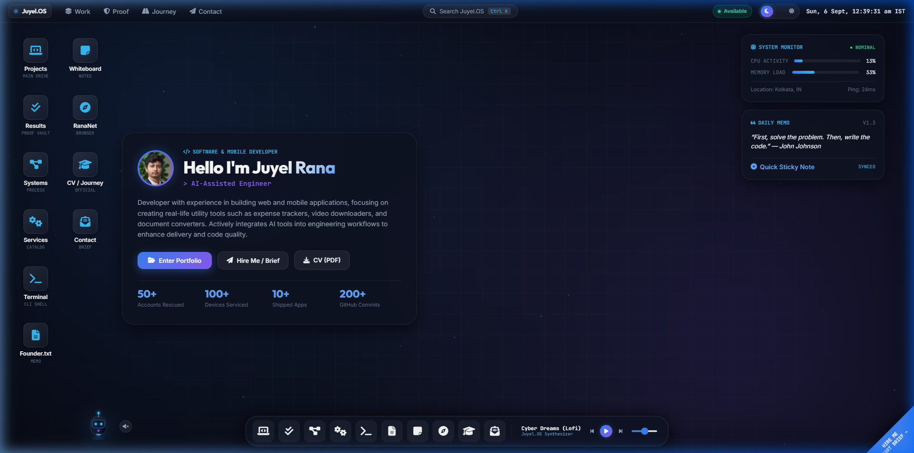
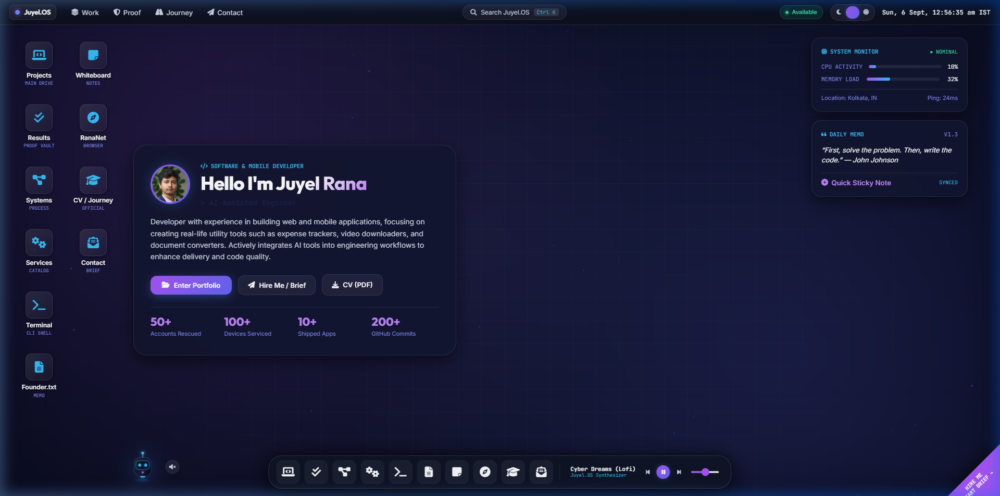
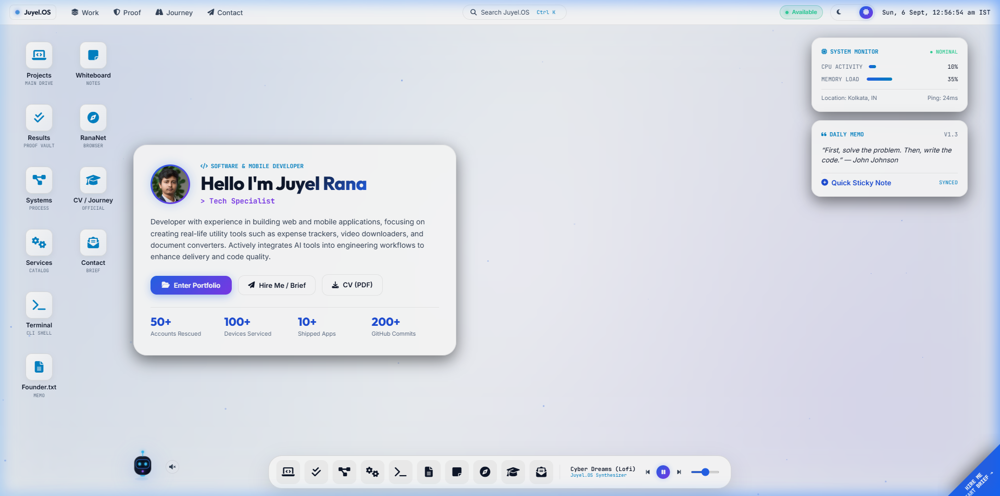
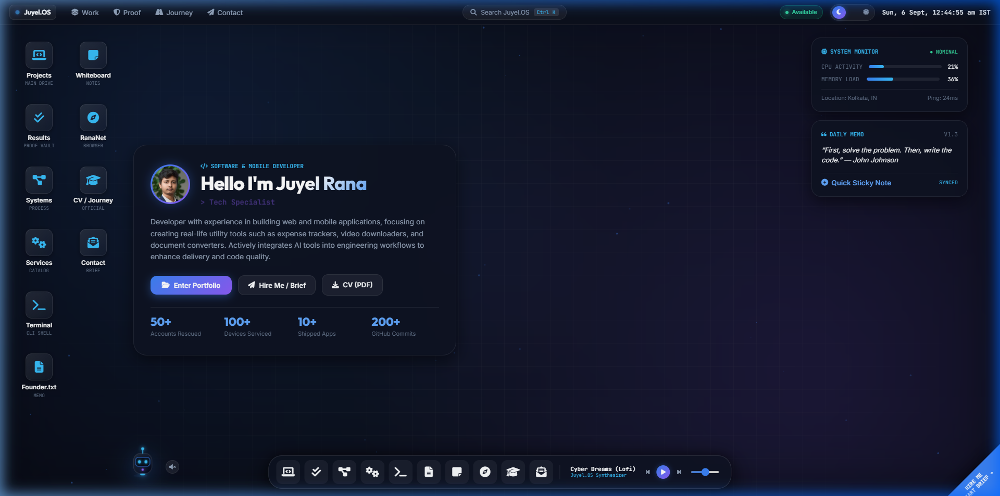

<div align="center">

# 🌌 Portfolio v2 (Juyel.OS) — Titanium VisionOS Web Desktop & Engineering Showcase

**A futuristic, VisionOS-inspired personal web desktop and interactive engineering showcase built with 100% pure Vanilla JavaScript, Glassmorphic CSS3, and the Web Audio API.**

[](LICENSE)
[](https://developer.mozilla.org/en-US/docs/Web/JavaScript)
[](https://developer.mozilla.org/en-US/docs/Web/CSS)
[](https://developer.mozilla.org/en-US/docs/Web/API/Web_Audio_API)
[](#-zero-framework-philosophy)
[](https://github.com/Rana0Codes/Portfolio-v2)

<br>

<p align="center">
  
</p>

### [⚡ Launch Live Preview](https://rana0codes.github.io/Portfolio-v2/) • [Explore Projects](#-applications-catalog) • [Report Issue](https://github.com/Rana0Codes/Portfolio-v2/issues) • [Contact Juyel](mailto:ranajuyel460@gmail.com)

</div>

---

## 💡 Why This Project Was Built (Concept & Motivation)

Most developer portfolios are static, read-only single-page scrolls. While informative, they rarely reflect what engineers actually do: **design, architect, and deliver complex, interactive, state-driven software systems**.

**`Juyel.OS`** reimagines the developer portfolio and work collection as a **fully functional, multi-window operating system running entirely in the client browser**. Instead of scrolling past static cards, visitors can:
- Freely open, drag, minimize, maximize, and stack application windows.
- Deep-dive into technical project case studies with problem-solution-outcome breakdowns.
- Run commands in an interactive developer terminal with autocomplete.
- Jot persistent notes on a draggable sticky-notes whiteboard.
- Listen to dynamically synthesized ambient soundscapes powered by the Web Audio API.
- Interact with **Astro-J**, an animated cyber-droid companion with a reactive mood state engine.

---

## 🛡️ Proof of Work & Verified Technical Experience

This project is not a theoretical concept; it serves as **concrete proof of hands-on software development experience, system architecture capabilities, and problem-solving track record**:

| Metric | Verified Milestone | Technical Scope & Impact |
| :---: | :--- | :--- |
| 🚀 **10+** | **Shipped Applications & Systems** | Production Flutter mobile applications, client-side web apps, file automation utilities, and responsive web engines. |
| 🔒 **50+** | **Accounts Recovered & Secured** | Systematic digital identity recovery (Facebook/Google/Instagram), 2FA implementation, and credential hardening protocols. |
| 📱 **100+** | **Devices Diagnosed & Restored** | Mobile firmware flashing, OS-level troubleshooting, memory bloat optimization, and hardware/software diagnostics. |
| 💻 **200+** | **GitHub Commits** | Continuous version-controlled engineering across production web and open-source repositories. |

### 🎯 Technical Competency Matrix
- **Modern Web Development**: Semantic HTML5, CSS3 Custom Properties & Glassmorphic reflections, Pure Vanilla JavaScript (ES6+ Modules), Web Audio API, Canvas 2D particle systems.
- **Mobile Engineering**: Flutter, Dart, Firebase Firestore (sub-second real-time listeners, offline persistence, conflict resolution).
- **Tooling & Backend**: Node.js, Python, Java, REST APIs, Git CLI, GitHub Pages automated workflows.
- **Security & Reliability**: Honeypot anti-spam integration, zero-leak API key architecture, sanitized DOM rendering, defensive exception handling.

---

## ⚡ Zero-Framework Philosophy: Pure Web Standards

This entire operating system was engineered **without third-party frontend frameworks** (no React, no Vue, no Angular, no bundlers, zero runtime overhead):

| Metric | Traditional Framework Portfolios | Juyel.OS (Vanilla Web Standards) |
| :--- | :--- | :--- |
| **Dependencies** | 50+ npm packages (200MB+ node_modules) | **0 Dependencies** |
| **Runtime Engine** | Heavy Virtual DOM diffing overhead | **Direct DOM updates (Native 60 FPS)** |
| **Audio Playback** | Heavy external MP3/WAV files | **Procedural Web Audio API synthesis (0 KB)** |
| **Persistence** | Remote database lock-in | **Local-First resilient `localStorage`** |
| **Cold Start Boot** | ~1.5s - 3.2s bundle parse time | **Instantaneous browser execution** |

---

## 🌟 Core Features

### 1. 🪟 Multi-Window Desktop Manager
- **Z-Index Layering Engine**: Automatically raises focused or clicked windows to the foreground.
- **Physics Dragging**: Smooth pointer-event bounded dragging with boundary detection.
- **macOS/VisionOS Controls**: Traffic-light controls with Close (`×`), Minimize (`−`), and Fullscreen/Maximize (`+`).
- **Active Dock Indicators**: Apple-style frosted glass shelf with glowing active-state indicators and live running dot status.

### 2. 🎨 Titanium VisionOS Glassmorphism (3 Themes)
Instant, zero-latency theme switching designed to exceed WCAG AA contrast standards:
- **Dark Obsidian** (Default): Deep space obsidian (`#070a13`), electric neon cyan (`#00ffb3`), and cobalt indigo.
- **Cosmic Indigo Night**: Midnight violet canvas (`#080b1e`) with luminous ultraviolet glow.
- **Frosted Pearl Day**: Apple-inspired high-contrast daylight pearl with crisp typography and subtle shadows.

### 3. 📂 Projects Drive & Technical Deep-Dive Modal
Browse curated mobile, web, and system utility applications. Clicking any project launches a comprehensive **Deep-Dive Modal** detailing:
- **Problem Statement**: Specific real-world bottlenecks and UX failures.
- **Technical Intervention**: Architecture, algorithms, and libraries selected.
- **Measurable Outcomes**: Speedups, offline sync latency, and security hardening.
- **Direct Repositories & Live Links**: Verified open-source codebases.

### 4. 🤖 Astro-J — Reactive AI Cyber Companion
- Levitating cyber droid stationed on the desktop with floating hover physics.
- **Mood State Engine**: Transitions dynamically between `idle`, `happy`, and `excited`.
- **Speech Bubble Messenger**: Offers contextual engineering tips, system guides, and greeting dialogues.
- **Sound Synthesis**: Procedural robotic chirps generated live via oscillator frequencies.

### 5. 💻 Interactive CLI Terminal (`Ctrl+K`)
A built-in shell that responds to developer commands:
- Commands supported: `help`, `projects`, `skills`, `bio`, `contact`, `theme`, `clear`, and `exit`.
- Global Spotlight search shortcut (<kbd>Ctrl</kbd> + <kbd>K</kbd> or <kbd>Cmd</kbd> + <kbd>K</kbd>) to instantly query apps and projects.

### 6. 📝 Persistent Sticky Notes Whiteboard
- Interactive draggable sticky-notes canvas (Yellow, Cyan, Green, Purple, Rose).
- Create, edit, reposition, and delete notes.
- **Versioned Local Storage**: Notes persist automatically across browser sessions under schema `personal-os-whiteboard-v1`.

### 7. 🎵 Offline Lo-Fi Audio Engine & Dynamic Frequency Visualizer
- Powered by an HTML5 `<audio>` engine paired with a Web Audio API `AnalyserNode` for real-time FFT frequency curve analysis.
- **4 Curated Offline Lo-Fi Tracks** (~7.7 MB compressed offline assets in `assets/audio/`):
  1. *Midnight Lo-Fi* (Chill Lofi Sleep & Code Session)
  2. *Deep Focus Flow* (Mellow Lofi Instrumental Beats)
  3. *Chasing That Feeling* (Atmospheric Aesthetic Lo-Fi)
  4. *Cyberpunk Groove* (Dynamic Retro Synthwave Chords)
- **Live 4-Bar Equalizer Waves**: Real frequency-driven equalizer bars in the system dock that dance dynamically with the audio track's actual amplitude and spectrum.
- **Full Player Ergonomics**: Scrubbable progress bar, real-time elapsed/duration timestamp (`mm:ss`), responsive volume slider with `localStorage` memory, and auto-advancing playlist queue.

---

## 🖼️ Visual Showcase

<div align="center">

### Project Inspector & Deep-Dive Analysis


<br><br>

### Dynamic Theme Variations (Cosmic Indigo & Frosted Pearl)
<table width="100%">
  <tr>
    <td width="50%" align="center">
      <b>🌌 Cosmic Indigo Night Mode</b><br><br>
      
    </td>
    <td width="50%" align="center">
      <b>☀️ Frosted Pearl Day Mode</b><br><br>
      
    </td>
  </tr>
</table>

<br>

### Astro-J Interactive Companion Droid


</div>

---

## 📂 Applications Catalog (Curated Work Showcase)

The operating system includes 10 dedicated workstation applications:

| Application | Window ID | Purpose & Capabilities |
| :--- | :--- | :--- |
| **Projects (Main Drive)** | `win-projects` | Detailed directory of featured mobile, web, and software tools. |
| **Results & Proof Vault** | `win-results` | Verified metrics: 50+ accounts recovered, 100+ devices diagnosed. |
| **Systems & Methodology** | `win-systems` | 4-step engineering loop: Discover, Architect, Build, Optimize. |
| **Services & Capabilities** | `win-services` | Commercial service packages for web, mobile, and technical support. |
| **CLI Terminal Shell** | `win-terminal` | Keyboard-driven command interpreter with custom commands. |
| **Founder Memo** | `win-founder` | Clean `.txt` notepad memo outlining engineering philosophy. |
| **Whiteboard & Notes** | `win-whiteboard` | Drag-and-drop sticky notes canvas with local persistence. |
| **RanaNet Browser** | `win-browser` | Internal browser interface with direct bookmarks to web resources. |
| **Curriculum Vitae** | `win-resume` | Interactive career journey timeline and 1-click PDF CV download. |
| **Commercial Inquiries** | `win-contact` | Spam-protected contact brief via Web3Forms + direct WhatsApp. |

---

## ⌨️ Keyboard Shortcuts

| Shortcut | Action | Description |
| :--- | :--- | :--- |
| <kbd>Ctrl</kbd> + <kbd>K</kbd> / <kbd>Cmd</kbd> + <kbd>K</kbd> | **Spotlight Search** | Focuses and launches global command search |
| <kbd>Tab</kbd> | **Focus Traversal** | Cycles focus through active window controls |

---

## 🚀 Quick Start & Local Setup

Because `Portfolio v2 (Juyel.OS)` is built entirely with standard ES6+ Modules, it runs natively on any static web server without compiling or building.

### 1. Clone or Download the Project
```bash
git clone https://github.com/Rana0Codes/Portfolio-v2.git
cd Portfolio-v2
```

### 2. Run Local Server (Choose Any)

#### Option A: Python 3 (Recommended - Zero Install)
```bash
python -m http.server 8085
```
Then open: **[http://localhost:8085](http://localhost:8085)**

#### Option B: Node.js / npx
```bash
npx serve .
```

#### Option C: VS Code Live Server
Right-click `index.html` inside VS Code and select **"Open with Live Server"**.

---

## 🌐 Deploying to GitHub Pages (Free 1-Click Hosting)

You can host this project on GitHub Pages in under 60 seconds:

1. Push this repository to GitHub (`https://github.com/Rana0Codes/Portfolio-v2`).
2. Go to your repository on GitHub and click **Settings** → **Pages**.
3. Under **Build and deployment** → **Source**, select **Deploy from a branch**.
4. Set Branch to **`main`** and folder to **`/ (root)`**, then click **Save**.
5. Your live operating system will be live at:
   ```
   https://rana0codes.github.io/Portfolio-v2/
   ```

---

## 📤 Project GitHub Repository

This project is maintained independently in its own dedicated repository:

```bash
# Repository: https://github.com/Rana0Codes/Portfolio-v2.git
git remote add origin https://github.com/Rana0Codes/Portfolio-v2.git
git branch -M main
git push -u origin main
```

---

## 📂 Project Structure

```
Portfolio-v2/
├── index.html                  # Core OS desktop shell, system bar, dock, and window mounts
├── LICENSE                     # MIT Open Source License
├── README.md                   # Comprehensive repository guide and architecture manual
├── robots.txt                  # Search engine crawl directives
├── sitemap.xml                 # Search engine indexing map
│
├── css/
│   ├── os-core.css             # Desktop layout, dock, system bar, ambient wallpaper
│   ├── os-themes.css           # Obsidian, Cosmic Indigo, and Day themes
│   ├── os-windows.css          # Window chrome, z-index stacking, dragging physics
│   ├── os-apps.css             # Applications layout (Projects, Proof, Systems, etc.)
│   └── os-companion.css        # Astro-J droid animations, hover float, speech bubble
│
├── js/
│   ├── app.js                  # Master application orchestrator & window registrations
│   ├── owner-profile.js        # Canonical author profile & project data contracts
│   ├── os-window-manager.js    # Multi-window lifecycle, dragging physics, focus stacking
│   ├── os-desktop.js           # Live clock, theme switcher, boot sequence, canvas particles
│   ├── os-apps.js              # Application renderers & project detail modals
│   ├── os-audio.js             # Web Audio API analyser & offline lo-fi audio engine
│   ├── os-companion.js         # Astro-J reactive mood engine, chirps, and dragging
│   ├── os-whiteboard.js        # Interactive sticky notes with localStorage persistence
│   └── os-terminal.js          # Command palette search (Ctrl+K) & CLI interpreter
│
└── assets/
    ├── audio/                  # Curated offline lo-fi tracks (128kbps MP3s)
    │   ├── midnight-lofi.mp3
    │   ├── deep-focus.mp3
    │   ├── chasing-feeling.mp3
    │   └── cyber-groove.mp3
    ├── profile-photo.jpg       # Authentic portrait photograph of Juyel Rana
    ├── cv/
    │   └── CV.pdf              # Official downloadable Curriculum Vitae
    ├── projects/
    │   ├── project1.jpg        # BachatGuru expense tracker showcase visual
    │   ├── project2.jpg        # All-in-One media downloader visual
    │   └── project3.jpg        # Image & PDF utility suite visual
    └── screenshots/            # High-resolution README preview assets
        ├── desktop-hero.png
        ├── project-detail-modal.png
        ├── astro-j-companion.png
        ├── theme-cosmic-indigo.png
        └── theme-frosted-pearl.png
```

---

## 🛠️ Technology Stack & Standards

- **Structure**: Semantic HTML5 (`<main>`, `<dialog>`, `<nav>`, `<footer role="toolbar">`)
- **Styling**: Vanilla CSS3 (Custom properties, CSS Grid, Flexbox, Backdrop filters, Glassmorphic reflections)
- **Logic**: ES6+ JavaScript Modules (Event-driven architecture, zero framework overhead)
- **Audio Engine**: W3C Web Audio API (`AnalyserNode`, real-time FFT frequency visualizer, HTML5 Audio)
- **Persistence**: Web Storage API (`localStorage` with schema versioning and defensive parsing)
- **Security**: Honeypot anti-spam protection, strict input sanitization, zero hardcoded secret keys.

---

## 🤝 Contributing

Contributions, issues, and feature requests are always welcome!

1. Fork the Project (`https://github.com/Rana0Codes/Portfolio-v2`)
2. Create your Feature Branch (`git checkout -b feat/NewCapability`)
3. Commit your Changes (`git commit -m "feat: add NewCapability"`)
4. Push to the Branch (`git push origin feat/NewCapability`)
5. Open a Pull Request

---

## 📄 License

Distributed under the **MIT License**. See [`LICENSE`](LICENSE) for details.ct (`https://github.com/Rana0Codes/juyel-os`)
2. Create your Feature Branch (`git checkout -b feat/NewCapability`)
3. Commit your Changes (`git commit -m "feat: add NewCapability"`)
4. Push to the Branch (`git push origin feat/NewCapability`)
5. Open a Pull Request

---

## 📄 License

Distributed under the **MIT License**. See [`LICENSE`](LICENSE) for details.

---

## 👤 Author & Connect

**Juyel Rana**  
*Software Developer & AI Systems Builder*

- **GitHub**: [@Rana0Codes](https://github.com/Rana0Codes)
- **LinkedIn**: [juyel-rana](https://www.linkedin.com/in/juyel-rana/)
- **YouTube**: [@Rana0Codes](https://www.youtube.com/@Rana0Codes)
- **X (Twitter)**: [@Rana0Codes](https://x.com/Rana0Codes)
- **WhatsApp**: [+91 7679862322](https://wa.me/917679862322)
- **Email**: [ranajuyel460@gmail.com](mailto:ranajuyel460@gmail.com)

<div align="center">
  <sub>Engineered with pure Vanilla JS and VisionOS Glassmorphism. If you like this project, please give it a ⭐️ on GitHub!</sub>
</div>
